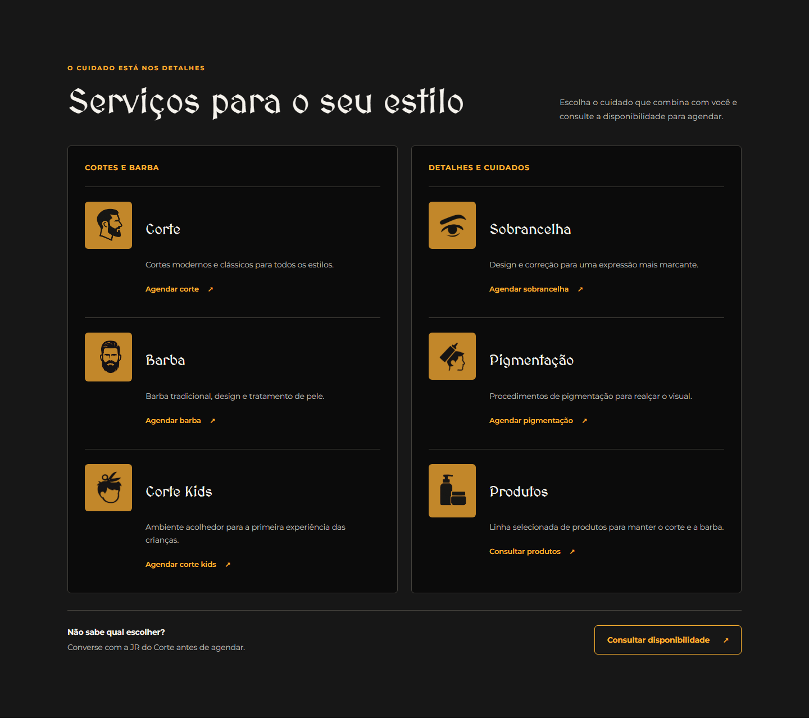

<h1 align="center">JR do Corte | Barbershop Landing Page</h1>
<p align="center">Commercial website • Responsive design • Accessibility • Web performance</p>
<p align="center"></p>

---

## Overview

A commercial landing page for a local barbershop in Lima Duarte, Brazil. The project brings together service discovery, contact navigation and a mobile-first experience, with particular attention to accessibility, performance and maintainability.

## Portfolio highlights

| Area | Implementation |
| --- | --- |
| Frontend | Responsive static website with vanilla JavaScript |
| Accessibility | Keyboard navigation, focus states and reduced-motion support |
| Performance | Optimized WebP assets and locally hosted fonts |
| Quality | Playwright regression tests and documented Lighthouse measurements |

The existing project documentation records 32 passing Chromium tests and Lighthouse performance scores of 93 (mobile) and 100 (desktop) in local laboratory measurements. These results are historical, not a new audit.

## Preview

<p align="center">
  
  
</p>

## Detailed technical documentation (Portuguese)

Landing page comercial em **HTML, CSS e JavaScript puro**, desenvolvida por **Sara Ingrid Sousa**. A versão 2 preserva logo, fotografias, preto/carvão/dourado e as fontes Montserrat e MedievalSharp do projeto original.

## Demo e estado da entrega

- Demo (GitHub Pages): https://saraingridsousa.github.io/Barbershop-landing-page/
- A refatoração foi integrada à `main`, preservando a branch de origem `refactor/landing-page-v2`. A atualização do site depende da implantação do GitHub Pages; o merge, isoladamente, não comprova que o deploy terminou.
- Protótipo original: https://www.figma.com/design/9bp2bKb3GzSPIOKU8YR1ZT/Untitled?node-id=0-1&p=f&t=PybKfsOmMYwlhle9-0

## Funcionalidades

- Hero com endereço completo em Lima Duarte e CTAs com feedback de hover/foco/pressão, sem loops e com movimento reduzido respeitado.
- Seis serviços originais organizados em dois menus; links diretos de agendamento no WhatsApp e ação adicional para consultar disponibilidade.
- Menu móvel com teclado, Escape, estados ARIA, fechamento após navegação e foco no destino. Navegação continua disponível sem JavaScript.
- Biografia com idade calculada automaticamente na abertura da página, imagens originais, mapa com título acessível e botão de rotas.
- Atalho flutuante dourado com o símbolo do WhatsApp e links diretos de agendamento confirmados; Instagram continua disponível.
- Sem avaliações fictícias: a captura de downloads do WhatsApp, antes repetida como depoimento, foi retirada da vitrine; o arquivo original foi preservado.
- Layout mobile-first, foco visível, alvos de toque de pelo menos 44px e suporte a movimento reduzido.
- Meta description, canonical, Open Graph e LocalBusiness apenas com informações presentes no repositório.
- Imagens WebP responsivas, dimensões reservadas, lazy loading fora do hero, fontes WOFF2 locais com `font-display: swap`. Sem jQuery, Font Awesome ou dependências em produção.

## Executar localmente

O site é estático e pode ser aberto diretamente em `index.html`. Para desenvolver e testar, use Node.js 22 ou superior:

```sh
npm ci
npx playwright install chromium
npm run serve
```

Acesse `http://127.0.0.1:4173`. O servidor é apenas de desenvolvimento, restrito ao loopback. Não há backend nem etapa de build necessária ao GitHub Pages. Preserve caminhos relativos ao publicar em um subdiretório do GitHub Pages; confira o prefixo após a renomeação.

## Testes

```sh
npm run check:html
npm run check:js
npm test
npm audit
node scripts/check-external-links.cjs
```

`npm test` inicia e encerra seu próprio servidor; pare `npm run serve` antes de executá-lo. Ferramentas de teste são apenas devDependencies.

Validação histórica anterior às mudanças de contato: **32 testes Chromium aprovados**, incluindo 320, 375, 390, 430, 768, 1024 e 1440px; axe sem violações nas regras WCAG A/AA selecionadas, com menu fechado e aberto; teclado, fallback sem JS, contatos inválidos e prefixo Pages. Inclui regressões de contraste do CTA em hover/foco/pressionado, movimento reduzido e seleção contextual de serviço. Isso não substitui auditoria manual completa com leitores de tela ou testes em Safari/Firefox. Evidência atual: `evidence/cta-services/playwright-results.json`.

Para preservar os relatórios históricos ao repetir a suíte, use `JR_EVIDENCE_DIR=evidence/cta-services npm test` (bash).

Lighthouse 12.6.1 local após esta melhoria: desempenho **93 mobile / 100 desktop** e **100** em acessibilidade, boas práticas e SEO nos dois perfis; LCP móvel ~1,9 s e CLS 0. São medições de laboratório em uma máquina, não promessa de Core Web Vitals de usuários reais. Resultados atuais em `evidence/cta-services/lighthouse-summary.json` e [refinamento de CTA/Serviços](docs/CTA_SERVICES.md). O relatório da primeira versão em `evidence/lighthouse-summary.json` é histórico (98/100), não uma medição nova.

Lighthouse foi usado em uma instalação temporária isolada, pois sua cadeia de dependências apresentou alertas de segurança. Ele **não integra o package.json/lock final**, cujo `npm audit` apresentou zero vulnerabilidades. Para repetir opcionalmente o mesmo experimento, instale-o em uma pasta temporária fora do repositório e execute:

```sh
npm install --prefix /caminho/temporario/jr-audit-tools lighthouse@12.6.1
LIGHTHOUSE_ROOT=/caminho/temporario/jr-audit-tools node scripts/lighthouse.cjs
```

O comando acima usa sintaxe bash; no Windows use caminhos nativos `C:/...`. A ferramenta de auditoria isolada mantém os alertas documentados; não a utilize como dependência do site ou servidor público. O teste normal não precisa dela.

## Contatos oficiais

- WhatsApp de agendamento: https://wa.me/553299827807 (link confirmado em 25/11/2026).
- Instagram: https://www.instagram.com/josedocorte7.

Todos os CTAs de atendimento e agendamento usam o link direto no HTML, sem redirecionador do Instagram, parâmetros de rastreamento ou dependência de JavaScript. Links de navegação interna e rotas continuam com seus destinos originais. Nenhuma mensagem é enviada automaticamente.

## Estrutura

- `index.html`: conteúdo, metadados e configuração de contato.
- `src/styles/`: tokens e estilos separados por seção; `depoimentos.css` corrige o nome anterior.
- `src/javascript/script.js`: menu e rolagem suave entre seções.
- `src/imagens/`: acervo original intacto; `optimized/` contém derivados e manifesto com hashes.
- `src/fonts/`: WOFF2, licenças OFL e origem dos downloads.
- `scripts/`: servidor, otimização e verificações opcionais.
- `tests/`: regressões e validações Playwright/axe.
- `docs/IMPLEMENTATION.md`: contrato, decisões, alterações, resultados e pendências.
- `evidence/`: screenshots, relatórios JSON e logs reais das execuções.

Para regenerar imagens/fontes: `node scripts/optimize-assets.cjs` (requer Chromium instalado e Python com Pillow). Os downloads de fontes podem variar futuramente; o manifesto registra a versão efetivamente gerada. Não modifique os SVGs/PNG/JPG originais como parte dessa geração.

## Capturas da versão local

[Serviços desktop](evidence/cta-services/services-desktop.png) · [Serviços no celular](evidence/cta-services/services-mobile.png)

As capturas completas em `evidence/screenshot-*.png` documentam a primeira refatoração; as sete larguras da melhoria atual são regeneradas com `JR_EVIDENCE_DIR=evidence/cta-services npm test` e preservadas localmente sem adicionar grandes imagens repetidas ao Git.

## Pendências antes de publicar

1. Confirmar atualidade do endereço e das demais informações da biografia; a idade é atualizada automaticamente.
2. Fornecer avaliações autênticas com autorização de publicação; não há avaliações legíveis no material atual.
3. Acompanhar a implantação do GitHub Pages após a integração autorizada à `main`. Preços e horários não foram inventados nem adicionados.
4. Fazer revisão com leitor de tela e Safari/Firefox; verificar cache/compressão e métricas após uma publicação autorizada.
